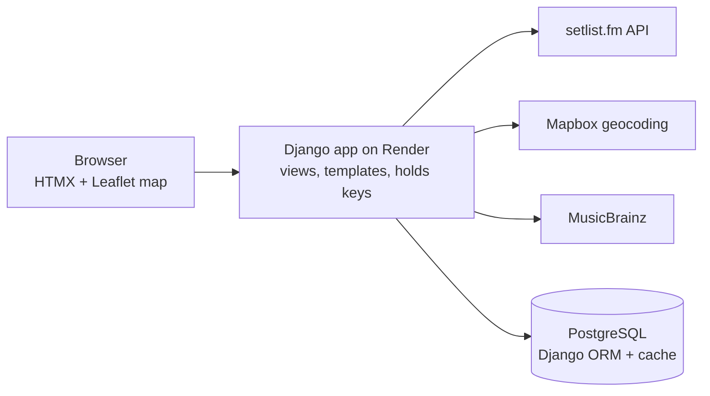

# Concert Diary — Product Requirements (v1)

Nov 3, 2026 · Josie Smith

## Overview

Concert Diary (working name) is a web platform for logging live shows: "Letterboxd for concerts." Version 1 is a free, single-player diary. Users build a profile, search for past shows and log them using setlist.fm data, then rate and review them. They pick a Top 3, and every show they've attended appears as a pin on a personal map.

**User Problem:** Concert memories are scattered across ticket emails, phone photos and fading recall. No single place tells a fan how many shows they've seen, where, and which ones mattered most.

**Vision of Product Solution:** Become the lifelong record of a fan's live-music life, then use that base to connect fans at the same show. Connecting fans is v2 and premium: pre- and post-show meetups.

## Goals, non-goals and success metrics

**Goals for v1**

- Make backfilling a concert history fast enough that a new user logs 10+ shows in their first session.
- Give every user a profile worth sharing: Top 3, stats and map.
- Validate demand for the diary before building social and meetup features.

**Non-goals for v1**

- Meetups, tailgates and location sharing (v2, premium)
- Friends, followers and activity feed
- Ticket sales or upcoming-show discovery
- Native mobile apps (v1 is a responsive web app)

**Success metrics**

| Metric | Target (proposed) |
| --- | --- |
| Shows logged in a user's first session | Median 10 or more |
| Time to log one show from search | Under 20 seconds |
| Users who write at least one review | 40% |
| Users who set a Top 3 | 60% |
| Users who return within 30 days | 30% |

Targets are starting assumptions to revisit after the first 50 users.

## Target users and personas

| Persona | Who they are | What they need from v1 |
| --- | --- | --- |
| Concert-goer (core) | Goes to 5+ shows a year and has years of history | Fast backfill, ratings, a record that lasts |
| New user | Just signed up with zero shows logged | A guided first log, plus value before any network exists |
| Profile visitor | A friend opening a shared profile link | A readable public profile, Top 3 and map, no account needed |
| Admin / moderator | The team running the service | Remove abusive reviews and fix bad event data |

V2 adds two meetup personas: the verified **host**, who creates a pre- or post-show meetup, and the **joiner**, who finds one and RSVPs. These replace the earlier "music lover" and "tailgater" stories.

## V1 scope

V1 ships six features, all free.

| # | Feature | Summary |
| --- | --- | --- |
| F1 | Profiles | Sign up, a public profile page (avatar, bio, city), lifetime stats (shows, artists, venues, cities) and a shareable URL |
| F2 | Search and log past shows | Search setlist.fm by artist, plus optional date, venue or city. One tap logs the show. Manual entry is the fallback when no match exists |
| F3 | Rate and review | A 0.5 to 5 star rating and an optional text review per show, with an optional spoiler flag on setlist talk |
| F4 | Edit ratings and reviews | Change or delete a rating, review or the log itself at any time; show an "edited" timestamp |
| F5 | Top 3 | Pick and order three logged shows that sit at the top of the profile |
| F6 | Map | A pin per venue attended, sized by visit count, with the date and artist(s) in a popup |

**Out of v1:** meetups, social graph and feed, photo uploads, setlist.fm attendance import (a fast follow; see Risks).

## User stories and acceptance criteria

Each story maps to a v1 feature. Acceptance criteria are written so a tester can mark each one pass or fail.

### F1 Profiles

**US-1.** As a new user, I want to sign up with email or Google so that I can start my concert diary in under a minute.

- [ ] Sign-up supports email + password and Google OAuth
- [ ] After sign-up I land on an onboarding screen that prompts me to log my first show
- [ ] A username is required, unique and used in my profile URL (/u/username)

**US-2.** As a concert-goer, I want a public profile showing my stats, Top 3 and map so that I can share my concert history.

- [ ] Profile shows avatar, display name, bio, home city and joined date
- [ ] Stats show total shows, unique artists, unique venues and unique cities, updated when I log or delete a show
- [ ] A logged-out visitor can view a public profile
- [ ] I can set my profile to private, which hides it from logged-out visitors

### F2 Search and log past shows

**US-3.** As a concert-goer, I want to search for a past show by artist and narrow by date, venue or city so that I can find the exact show I attended.

- [ ] Typing an artist name returns matching setlist.fm events, newest first
- [ ] Filters for year, venue and city narrow the results
- [ ] Each result shows artist, date, venue and city
- [ ] Results load in under 2 seconds for cached artists

**US-4.** As a concert-goer, I want to log a show in one tap from search results so that I can rebuild my history quickly.

- [ ] Tapping "Log" adds the show to my diary and confirms it on screen
- [ ] Logging the same event twice is blocked with a message
- [ ] The show's venue appears as a pin on my map without a page reload
- [ ] Median time from search to logged show is under 10 seconds in testing

**US-5.** As a concert-goer, I want to add a show manually when it isn't on setlist.fm so that small local gigs count too.

- [ ] Manual form requires artist, date and venue name; city is required for map placement
- [ ] Manual shows are marked "user-added" and appear in stats and on the map

**US-6.** As a concert-goer, I want to see my diary as a list sorted by date so that I can browse my history.

- [ ] Diary lists every logged show, newest first, with rating and review snippet
- [ ] I can sort by date or rating and filter by year

### F3 Rate and review

**US-7.** As a concert-goer, I want to rate a show from 0.5 to 5 stars and write a review so that I remember how it felt.

- [ ] Rating uses half-star steps from 0.5 to 5; rating is optional
- [ ] Review is optional and up to 5,000 characters
- [ ] Rating and review can be added at log time or later
- [ ] My review shows on my diary entry and on the show's detail page

### F4 Edit ratings and reviews

**US-8.** As a concert-goer, I want to edit or delete my rating, review or log so that my diary stays accurate.

- [ ] I can edit the rating and review text of any show I logged
- [ ] Edited reviews show an "edited" label with the date
- [ ] Deleting a log asks for confirmation, then removes it from my diary, stats, map and Top 3
- [ ] Only the author can edit or delete their own entries

### F5 Top 3

**US-9.** As a concert-goer, I want to pick and order my Top 3 shows so that visitors see the shows that mattered most.

- [ ] I can choose up to 3 shows from my logged shows only
- [ ] I can reorder them by drag-and-drop or up/down controls
- [ ] Top 3 appears at the top of my profile with artist, date and venue
- [ ] Removing a show from my diary removes it from Top 3

### F6 Map

**US-10.** As a concert-goer, I want a map with a pin for every venue I've been to so that I can see where my music life has taken me.

- [ ] Each venue I've attended shows one pin; multiple visits show a count
- [ ] Clicking a pin lists the shows there, with date and artist(s)
- [ ] The map opens zoomed to fit all my pins
- [ ] Shows without coordinates are listed under "Not on the map" with a fix-location option

### Admin

**US-11.** As a moderator, I want to hide reported reviews so that public profiles stay safe.

- [ ] Any logged-in user can report a review
- [ ] Moderators can hide a review, which removes it from public views but keeps it for the author

## Data model

Seven tables in Postgres, plus a join table linking attendances to tags. Events, artists and venues are cached from setlist.fm the first time someone logs them, so later lookups skip the API.

| Table | Key fields | Notes |
| --- | --- | --- |
| users | id, username, display_name, avatar_url, bio, home_city, is_private, created_at | Django auth user + a Profile model |
| artists | id, mbid, name | mbid = MusicBrainz ID, which setlist.fm returns |
| venues | id, setlistfm_id, name, city, country, lat, lng | lat/lng from geocoding; setlist.fm gives only city coordinates |
| events | id, setlistfm_id, artist_id, venue_id, event_date, tour_name, source | source = setlistfm or user |
| attendances | id, user_id, event_id, rating, review, review_has_spoilers, top3_rank, created_at, updated_at | Unique on (user_id, event_id); top3_rank is 1 to 3 or null |
| reports | id, attendance_id, reporter_id, reason, status | Moderation queue |
| tags | id, name, owner_id | owner_id null = premade tag (seeded); set = that user's custom tag. Names max 24 characters, unique per owner ignoring case. Linked to attendances many-to-many |

V2 adds a `meetups` table (event_id, host_id, approx_location, starts_at, ends_at, visibility, expires_at) and `rsvps`.

## Tech stack and external APIs

The stack is chosen so one developer can ship v1 in Python: a single Django app with server-rendered pages, PostgreSQL, and HTMX for interactivity, hosted on Render.

| Layer | Choice | Why |
| --- | --- | --- |
| Framework | Django 5 (Python) | Auth, ORM, migrations, forms and admin built in |
| Pages | Django templates + HTMX + Tailwind CSS (or Pico.css) | One-tap logging, star ratings and Top 3 reordering without a JavaScript framework |
| Backend logic | Django views + a `services/setlistfm.py` module using `requests` | Keeps the setlist.fm API key on the server |
| Database | PostgreSQL via the Django ORM (SQLite while prototyping) | Relational data; add GeoDjango + PostGIS for v2 location queries |
| Cache | Django cache framework (Redis in production) | Cuts setlist.fm calls under rate limits |
| Auth | Django auth + django-allauth (email + Google) | Sign-up, login, password reset and OAuth |
| Moderation | Django admin | Review reports and hide reviews with little custom code (US-11) |
| Map | Leaflet + OpenStreetMap tiles | Free, no key; reads venues from a JSON view |
| Geocoding | Mapbox Geocoding API | Turns venue name + city into exact lat/lng |
| Show data | [setlist.fm API](https://api.setlist.fm/docs/1.0/index.html) | Search setlists by artist, date, venue, city |
| Artist data | MusicBrainz | Canonical artist IDs and images |
| Hosting | Render (or Railway, Fly.io) | Managed Postgres and deploys from GitHub |

**Django apps**

- `accounts`: profiles, sign-up, privacy setting
- `shows`: Artist, Venue, Event, Attendance and Report models; search, log, review, edit, Top 3
- `maps`: venue JSON endpoint and the map page

If a mobile app comes later, add Django REST Framework so the same backend serves it.

**v1 architecture**

The browser only talks to the Django server, which keeps API keys private and caches show data in Postgres.

**setlist.fm notes**

- Requests need an API key sent in the `x-api-key` header; call it only from the server.
- The standard key is for non-commercial use. Get written approval before premium launch.
- Rate limits are tight, so cache every event, artist and venue you fetch and debounce search input.
- Venues come with city coordinates only, hence the geocoding step.

## V2 (premium): meetups and tailgates

Meetups are the paid differentiator and ship only after v1 has enough users at the same shows. Draft stories below; safety requirements are a launch gate, not a nice-to-have.

**US-12 (host).** As a premium user going to a show, I want to post a pre- or post-show meetup so that I can meet fellow fans.

- [ ] A meetup is tied to one upcoming event, with a time window and an approximate area (not an exact pin)
- [ ] The host chooses visibility: friends only, or everyone who has marked the show as "going"
- [ ] The meetup expires and its location is deleted 12 hours after the show

**US-13 (joiner).** As a fan going to a show, I want to see meetups for that show and RSVP so that I have people to go with.

- [ ] I see meetups only for events I've marked as "going"
- [ ] The exact meeting spot is revealed only after the host accepts my RSVP
- [ ] I can leave an RSVP at any time

**Safety requirements (launch gate)**

- [ ] Block and report available on every meetup and profile
- [ ] Verified email required; phone verification for hosts
- [ ] No exact location shown before RSVP acceptance
- [ ] Clear community guidelines, including venue tailgating rules and no promotion of underage drinking
- [ ] A moderation queue with response targets

## Competitive landscape

Concert logging is crowded; meetups at the show are not. V1 must match the basics, and v2 is where the product stands apart.

| Product | What it does | Gap we fill |
| --- | --- | --- |
| [setlist.fm](https://www.setlist.fm) | Setlist wiki with "I was there" attendance | No reviews, Top 3 or social layer |
| [Concert Archives](https://www.concertarchives.org) | Concert history logging | Dated design, no meetups |
| [Banded](https://banded-web.pages.dev/blog/letterboxd-for-concerts) | Pitched as "Letterboxd for concerts" | No meetup layer |
| [Jukeboxd](https://www.producthunt.com/products/jukeboxd/launches), [Gigvault](https://apps.apple.com/app/id6765689126), [Melo](https://apps.apple.com/app/id6763952800) | New indie concert trackers, mostly iOS | Web-first profiles and shareable maps |
| Songkick, Bandsintown | Upcoming-show alerts and tickets | No diary or reviews |

**Differentiation:** a shareable web profile with Top 3 and map in v1, then show-day meetups in v2.

## Risks, open questions and milestones

**Risks**

| Risk | Mitigation |
| --- | --- |
| setlist.fm terms block commercial use | Ask for approval early; keep manual entry and the local cache as a fallback |
| API rate limits slow search | Cache results, debounce input, and search the local cache first |
| Backfill is still too slow | Fast follow: import a user's setlist.fm "attended" list |
| Crowded market | Lead with the shareable profile and map; test meetup demand before v2 |
| Meetup safety incidents (v2) | Safety launch gate in the v2 section |

**Open questions**

- [ ] Final product name and domain
- [ ] Premium price point and what else it includes (for example, a yearly "Concert Wrapped")
- [ ] Mapbox or Leaflet + OpenStreetMap
- [ ] Should private profiles still count in public show and venue stats?

**Milestones**

1. Validate: 10 to 15 user interviews and a waitlist landing page
2. Clickable front-end prototype with mock data (all six v1 screens)
3. Usability test the prototype with 5 users and revise
4. Build: auth, profiles and the database
5. Build: setlist.fm search and logging, ratings and reviews
6. Build: Top 3, map and public profiles
7. Closed beta with 50 users, measured against the success metrics
8. Decide on v2 meetups

## Sources

- [setlist.fm API documentation](https://api.setlist.fm/docs/1.0/index.html)
- [Banded: Letterboxd for concerts](https://banded-web.pages.dev/blog/letterboxd-for-concerts)
- [Banded: best concert tracking apps 2026](https://banded-web.pages.dev/blog/best-concert-tracking-apps-2026)
- [Jukeboxd on Product Hunt](https://www.producthunt.com/products/jukeboxd/launches)
- [Gigvault](https://apps.apple.com/app/id6765689126)
- [Melo: Concert Tracker](https://apps.apple.com/app/id6763952800)
